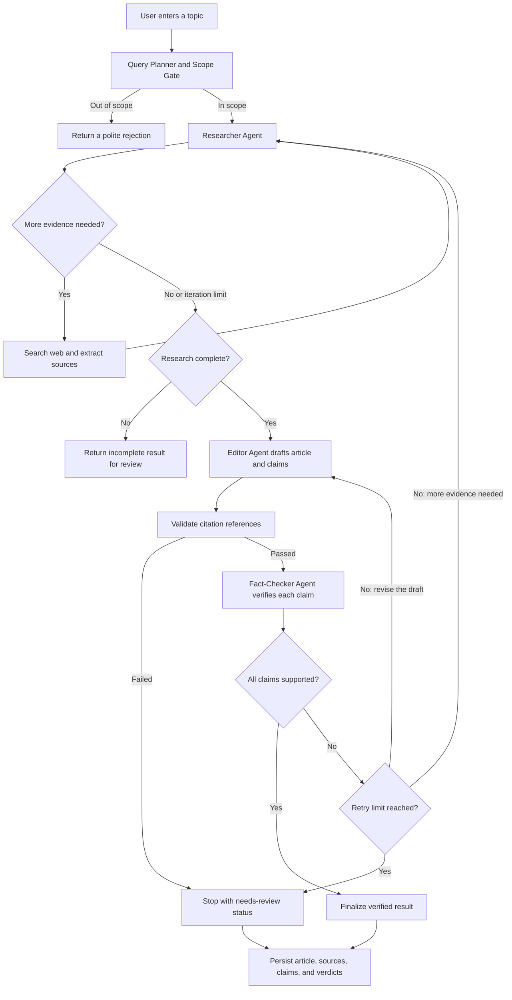

# Newsroom AI

Newsroom AI is an agentic AI application that researches current or historical news, writes a cited article, and checks its claims against collected evidence. It also provides a categorized top-news feed.

> **Note:** A `verified` result means the application's citation checks and fact-checking workflow passed. It is not a guarantee of truth. Review the linked sources before relying on or publishing a story.

## Features

- Browse recent headlines by category, with cached top-news discovery.
- Turn a topic into a focused news search plan, including current and historical queries.
- Research stories using web search and source extraction.
- Draft articles with evidence-linked citations.
- Validate citations and fact-check claims individually.
- Store stories, articles, sources, claims, and fact-check results in PostgreSQL.
- Trace pipeline stages, outcomes, and timings with Langfuse.
- Reject non-news requests before research begins.

## Tech stack

- **Backend:** Python 3.12+, FastAPI, LangGraph, LangChain, OpenAI
- **Frontend:** React, TypeScript, Vite
- **Database:** PostgreSQL 17, SQLAlchemy async, Alembic
- **Search and extraction:** Tavily, HTTP/BeautifulSoup, Firecrawl fallback
- **Observability:** Langfuse
- **Local development:** Docker Compose, `uv`, npm

## Agentic workflow



The scope gate runs before the research graph. An out-of-scope query or a query-planning failure must not continue into web research or article generation.

## What makes it agentic?

Newsroom AI is more than a single prompt that generates an article:

- **Role-based agents:** The Researcher gathers evidence, the Editor writes from that evidence, and the Fact Checker independently reviews the article's claims.
- **Tool use:** The Researcher can call search tools and examine the results before continuing.
- **Conditional routing:** The LangGraph workflow uses the state of the run to decide whether to draft, verify, revise, research further, or stop.
- **Feedback loops:** Unsupported or unverifiable claims can trigger another research pass or a revised draft, within bounded retry limits.
- **Structured state and memory within a run:** Research evidence, queries, citations, and claim verdicts are carried through the workflow rather than handled as isolated prompts.
- **Scope control:** The Query Planner classifies intent before building the news search plan and fails closed if that check fails.

## Problems faced and how they were addressed

### 1. Non-news requests reached the news pipeline

A request such as *“Can you help me build a website?”* could be interpreted as a search topic instead of a request for general assistance.

**Solution:** Added a scope decision (`is_in_scope`) to the Query Planner, explicit in-scope and out-of-scope rules, early rejection before research or persistence, fail-closed handling for planner failures, and regression tests. News queries about the same topic—such as developments in AI website builders—remain eligible.

### 2. Citations could be present without proving a claim

A source mentioning the same topic does not necessarily support a specific statement.

**Solution:** The Editor supplies evidence references for article sections and structured claims. Citation references are validated against collected evidence, and the Fact Checker assesses each claim independently, recording verdicts and supporting or contradicting evidence. Failed checks can trigger a bounded revision or research loop.

### 3. Some publisher pages reject direct extraction

A direct request can return an access error or too little readable text.

**Solution:** The app supports a Firecrawl fallback when appropriate and configured. Publisher access restrictions should be respected; the system should not try to bypass them.

### 4. Multi-step workflows are difficult to debug and tune

Slow searches, repeated research passes, and database persistence can all contribute to end-to-end latency.

**Solution:** Langfuse records stage-level traces and timing metadata to make the bottleneck visible. Research iterations and fact-check retries are bounded. Performance can then be improved based on measured traces rather than guesswork.

## Run locally

### Requirements

Python 3.12+, [`uv`](https://docs.astral.sh/uv/), Node.js/npm, Docker, and API credentials for OpenAI, Tavily, and Firecrawl. Langfuse credentials are used for tracing.

### 1. Configure environment

From the repository root:

```bash
cp .env.example .env
```

Add your credentials to `.env`. Do not commit this file or expose API keys in frontend code.

### 2. Start the database and install dependencies

```bash
docker compose up -d postgres
uv sync --dev
```

### 3. Apply migrations and start the backend

```bash
cd backend
uv run alembic upgrade head
uv run uvicorn app.main:app --reload --port 8000
```

API docs: <http://localhost:8000/docs>

### 4. Start the frontend

In a second terminal, from the repository root:

```bash
cd frontend
npm ci
npm run dev
```

Open <http://localhost:5173>.

### Tests

```bash
cd backend
uv run pytest -q
```

Build the frontend:

```bash
cd frontend
npm ci
npm run build
```

## Limitations

News quality depends on the available sources, provider availability, and model output. Automated checks help identify citation and claim problems, but they do not replace editorial review. The Docker Compose database settings are for local development, not production deployment.

## Repository

[GitHub: prakharsri21/newsroom-ai](https://github.com/prakharsri21/newsroom-ai)
