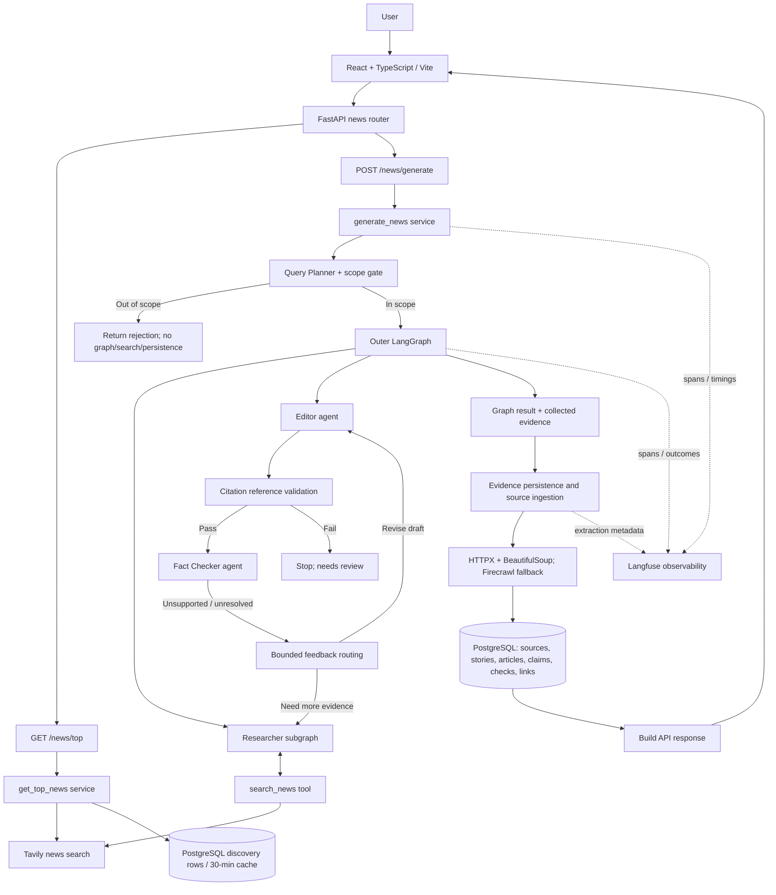
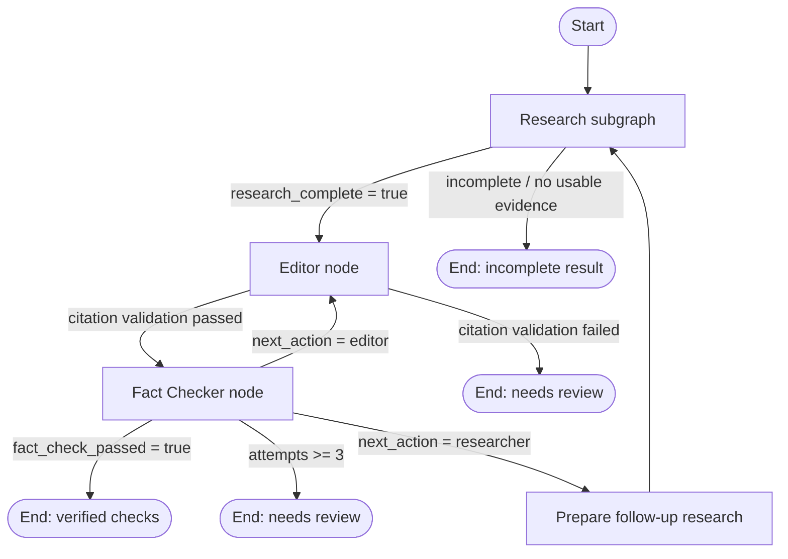
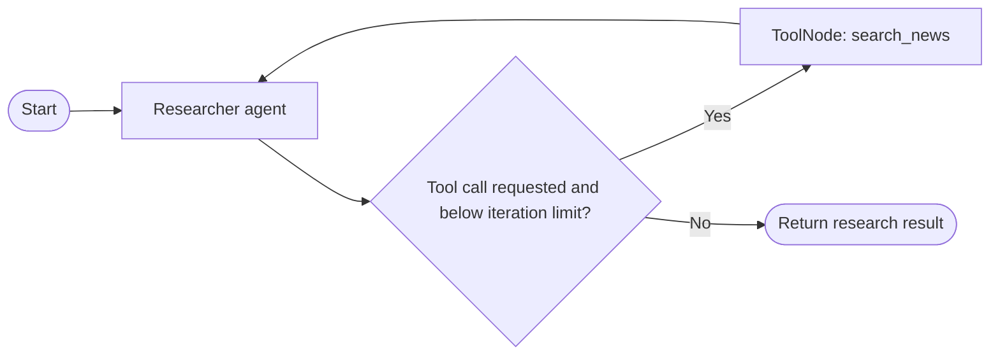
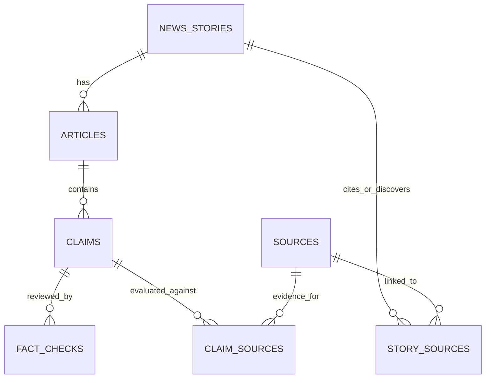

# Newsroom AI — Architecture

> Source-grounded documentation based on the repository's `main` branch. This diagram reflects code paths found in the implementation; planned components are not assumed.

## 1. System map

### Important separation

- The top-news feed is a separate path from article generation. Discovery stories use the `news_stories` table and a `last_refreshed_at` timestamp; a fresh cache is reused for 30 minutes.
- The Query Planner checks scope before the graph runs. Out-of-scope requests stop before searching, article generation, evidence persistence, or database writes.
- The Researcher and the Editor/Fact Checker operate on the evidence held in graph state. After the graph returns, the service fetches and normalizes source pages while persisting evidence, then stores the article and claim-verification results.
- A `verified` result means the implemented citation and claim checks passed. It is not a guarantee that every claim is true; review the source links before publication.

## 2. Outer LangGraph workflow

## 3. Inner Researcher graph

The Researcher loop is capped at four iterations. `search_news` calls Tavily, with up to three results per call; current-news searches can widen the date window once when a narrower search yields no results. Follow-up research preserves already collected evidence while resetting the prior tool-call messages.

## 4. Data model

| Entity | Role |
|---|---|
| `news_stories` | Story headline, summary, category, publication metadata, discovery flag and cache refresh timestamp. |
| `articles` | Generated article content and version; foreign key to `news_stories`. |
| `sources` | Canonical URL, publisher/domain, dates and extracted content; URL is unique. |
| `claims` | Discrete factual claims extracted from an article, with status and confidence. |
| `fact_checks` | Verdict, confidence and rationale for a reviewed claim. |
| `story_sources` | Link table connecting stories and sources. |
| `claim_sources` | Link table connecting claims and reviewed evidence, including support/contradiction relationship and excerpt. |

Langfuse tracing is external observability, not a table in the application schema. PostgreSQL access uses async SQLAlchemy sessions, and Alembic manages schema migrations.

## 5. Useful source files

- [Frontend request and display flow](../../frontend/src/App.tsx)
- [FastAPI routes](../../backend/app/api/news.py)
- [Generation orchestration and persistence](../../backend/app/services/generation.py)
- [Query Planner and scope gate](../../backend/app/graph/query_planner.py)
- [Outer workflow routing](../../backend/app/graph/graph.py)
- [Inner Researcher graph](../../backend/app/graph/research_graph.py)
- [Researcher agent](../../backend/app/graph/researcher_agent.py)
- [Editor agent](../../backend/app/graph/editor_agent.py)
- [Fact Checker agent](../../backend/app/graph/fact_checker_agent.py)
- [Search tool](../../backend/app/graph/tools/research_tools.py)
- [Source page extraction and Firecrawl fallback](../../backend/app/services/web_fetch.py)
- [Source ingestion](../../backend/app/services/source_ingestion.py)
- [Top-news discovery and cache](../../backend/app/services/top_news.py)
- [SQLAlchemy models](../../backend/app/models/)

## Notes

This document is architectural documentation only. It does not change runtime code, prompts, database schema or API behavior.